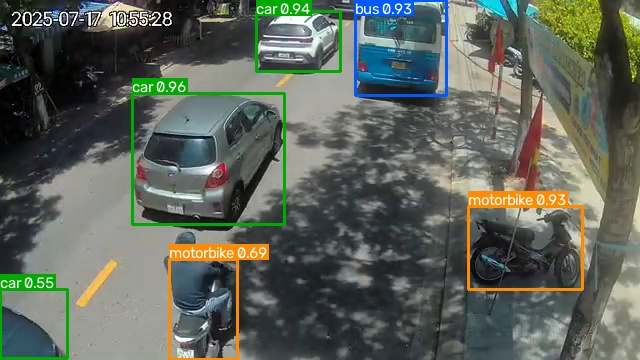

# Vietnam Traffic App

A Streamlit app that detects and counts vehicles (car, motorbike, bus, truck) in images, videos and live traffic cameras in Vietnam, using a YOLO26n model trained on Vietnamese street scenes.



## Features

- **Run on Image**: upload an image and count the vehicles in it.
- **Run on Video**: upload a video, count vehicles frame by frame and optionally record and download the annotated video.
- **Run on Live Camera**: pick one of the city traffic cameras, count vehicles every 15 seconds and follow the counts on a chart.
- Adjustable detection confidence in every mode.

Traffic-jam notifications are not part of the app for now, see [TRAFFIC_JAM_ROADMAP.md](TRAFFIC_JAM_ROADMAP.md).

## Quick start

Tested with Python 3.14.

```bash
python -m venv .venv
.venv\Scripts\activate        # Linux/macOS: source .venv/bin/activate
pip install -r requirements.txt
streamlit run app.py
```

The trained weights are in [models/yolo26n.pt](models/yolo26n.pt). Live cameras need internet access.

Live camera images come from the [Ho Chi Minh City Traffic Information Portal](http://giaothong.hochiminhcity.gov.vn), which refreshes each camera about every **15 seconds**. The camera list is in [cameras.py](cameras.py).

## Model

| | |
|---|---|
| Architecture | YOLO26n ([Ultralytics](https://docs.ultralytics.com)), fine-tuned from the pretrained `yolo26n.pt` |
| Classes | `car`, `motorbike`, `bus`, `truck` |
| Input size | 640 (inference uses the same `imgsz`, see `IMGSZ` in [yolo_predictor.py](yolo_predictor.py)) |
| Dataset | [vehicle-danang-2025](https://www.kaggle.com/datasets/keyshiftf/vehicle-danang-2025/data): 20,438 train / 5,839 val / 2,921 test images, 640x360 |
| Training | 44 epochs (early stopping, best epoch 39) on a Kaggle GPU, see [notebook/train-yolo26n.ipynb](notebook/train-yolo26n.ipynb) |

### Results (best weights)

| Split | Precision | Recall | mAP50 | mAP50-95 |
|---|---|---|---|---|
| Validation | 0.877 | 0.833 | 0.902 | 0.786 |
| Test | 0.873 | 0.838 | 0.904 | 0.785 |

Per class on the test split:

| Class | Instances | Precision | Recall | mAP50 | mAP50-95 |
|---|---|---|---|---|---|
| car | 15,876 | 0.927 | 0.925 | 0.977 | 0.891 |
| motorbike | 7,586 | 0.885 | 0.908 | 0.958 | 0.766 |
| bus | 232 | 0.867 | 0.841 | 0.912 | 0.833 |
| truck | 204 | 0.812 | 0.677 | 0.770 | 0.649 |

Known limitations:

- **Bus and truck are weak.** They are only about 1% of the labels each, and the model often confuses them with each other and with cars.
- **The numbers above are probably optimistic.** The train, val and test splits were drawn at random from video frames of the same cameras, so near-identical frames appear in several splits. Expect lower accuracy on cameras and places that are not in the dataset. A split by camera or video would give a more honest estimate.

## Project structure

```
app.py                 Streamlit app
yolo_predictor.py      YOLO wrapper used by the app
cameras.py             Traffic camera list (id and name)
get_data.py            Collect frames from the cameras into data/collected/
utils/utils.py         Camera download, drawing and counting helpers
models/yolo26n.pt      Trained weights
notebook/              Training and evaluation notebook (Kaggle)
assets/                Image shown on the About page
TRAFFIC_JAM_ROADMAP.md Notes for the future traffic-jam feature
```

## Training and evaluation

[notebook/train-yolo26n.ipynb](notebook/train-yolo26n.ipynb) trains the model on Kaggle, evaluates the best weights on the validation and test splits, and produces the curves, confusion matrices, validation-vs-test comparison and a zip with the artifacts. Run its cells from top to bottom; the dataset paths at the top point to the Kaggle dataset.

After retraining, replace `models/yolo26n.pt` with the new `best.pt`. If you train with a different `imgsz`, update `IMGSZ` in [yolo_predictor.py](yolo_predictor.py) as well.

## Collecting more data

To gather extra images for labeling (for example more bus and truck examples):

```bash
python get_data.py
```

It saves one frame per camera every 15 seconds into `data/collected/` until you stop it.
